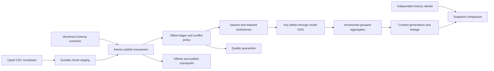

# From staged chunks to published views

`contracts.py` owns typed fields, compatibility rules, CDC envelopes and declarative model definitions. `warehouse.py` owns staging and publication transactions. `oracle.py` independently scans history and rebuilds model results. `experiments.py` injects duplicates, late events, schema changes and failures, then compares committed snapshots and lineage.

The mutation boundary is SQLite publication. Staging is visible only through staging tables; analytical snapshots expose committed source/model rows, offset checkpoints and lineage together. Untrusted row values never construct SQL identifiers or executable code. Source/model names are bounded validated names and SQL values use parameters.
